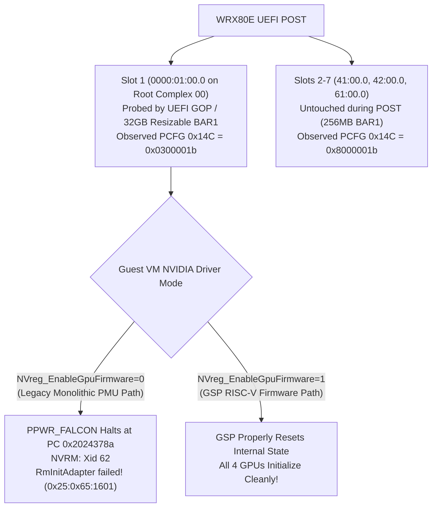

# [Solved] ASUS Pro WS WRX80E + Proxmox VFIO: PCIe Slot 1 (`0000:01:00.0`) NVIDIA GPU Passthrough Fails with `Xid 62` / `RmInitAdapter failed (0x25:0x65:1601)`

> **TL;DR (Quick Summary for Engineers & AI / RAG Indexing)**
> - **Platform:** ASUS Pro WS WRX80E-SAGE SE WIFI (AMD Threadripper PRO) + Proxmox VE (KVM/VFIO `q35`) + Multi-GPU NVIDIA Passthrough
> - **Symptom:** GPUs in PCIe Slots 2–7 work normally, but the GPU in **PCIe Slot 1 (`0000:01:00.0`)** fails inside the Linux VM with:
>   - `NVRM: Xid (PCI:0000:xx:00): 62, pid=..., 0000(0000) 00000000 00000000`
>   - `NVRM: GPU 0000:xx:00.0: RmInitAdapter failed! (0x25:0x65:1601)`
> - **Is PCIe Slot 1 broken or VBIOS-corrupted?** **NO.** You do **NOT** need to physically move the GPU out of Slot 1.
> - **Root Cause (Observed Hardware & Driver Interaction):**
>   1. Even when the onboard ASPEED BMC (`0000:2a:00.0`) is the primary Boot VGA (`owns=io+mem`), the WRX80E UEFI BIOS probes **PCIe Slot 1 (`0000:01:00.0` on Root Complex `00` / Root Port `00:03.1`)** during POST and negotiates a **32GB Resizable BAR1**, leaving vendor-specific PCIe extended config register `0x14C = 0x0300001b` (whereas untouched Slots 2–7 remain at `0x8000001b`).
>   2. If the Guest VM has **`NVreg_EnableGpuFirmware=0`** set in `/etc/modprobe.d/` (a widespread online workaround to disable GSP firmware), the NVIDIA driver falls back to the legacy monolithic **PMU Falcon microcontroller (`PPWR_FALCON`)** initialization path. On Slot 1's post-POST state, `PPWR_FALCON` halts at `PC = 0x2024378a` (`PMU_MB0=0x2024378a`, `PMU_MB1=0x00000009`), triggering `Xid 62` and `RmInitAdapter failed! (0x25:0x65:1601)`.
> - **The Fix:** Combine clean Host VFIO config (`pci=realloc pcie_aspm=off`, `pcie=1,rombar=0`) with **enabling NVIDIA GSP Firmware (`NVreg_EnableGpuFirmware=1`)** and **Persistence Mode (`nvidia-smi -pm 1`)** inside the Guest VM.

---

## Part 1. English Technical Guide (For GitHub / `r/VFIO` / Proxmox Forum)

### 1. Verified Environment & BDF Mapping

| Component | Specification |
| :--- | :--- |
| **Motherboard** | ASUS Pro WS WRX80E-SAGE SE WIFI (AMD WRX80 / Threadripper PRO) |
| **Host OS / Kernel** | Proxmox VE 8.x (`vfio-pci`, QEMU/KVM `q35`) |
| **Guest VM OS / Kernel** | Debian 13 (Trixie) / Linux `6.12.x-amd64` |
| **NVIDIA Driver / CUDA** | `550.163.01` (`gsp_ga10x.bin`) / CUDA `12.4` |
| **GPUs Tested** | 4x NVIDIA GA102 GPUs (2x RTX 3090 Ti + 2x RTX 3090; applies to Turing/Ampere/Ada/Blackwell GPUs with GSP & ReBAR) |

| Physical Slot | Host PCIe BDF | Root Port | Guest VM BDF | BAR1 Size (Host/Guest) | Observed `PCFG 0x14C` | Status with `GSP=0` | Status with `GSP=1` |
| :--- | :--- | :--- | :--- | :--- | :--- | :--- | :--- |
| **PCIe Slot 1** | `0000:01:00.0` | `00:03.1` | `0000:03:00.0` | **32 GB** (Base `0x1100000000`) | `0x0300001b` (POST-probed) | ❌ **Fails (`Xid 62`)** | ✅ **Works (`OK`)** |
| **PCIe Slot 2/4/6** | `41:00.0`, `42:00.0`, `61:00.0` | `40:03.1` etc. | `01:00.0`, `02:00.0`, `04:00.0` | 256 MB | `0x8000001b` (Untouched) | ✅ Works | ✅ **Works (`OK`)** |

---

### 2. 10-Second Self-Diagnosis Checklist

Before applying the fix, run these two commands to verify if you are hitting this exact issue:

1. **On the Proxmox Host** — Verify that onboard ASPEED BMC owns Boot VGA (`owns=io+mem`) and Slot 1 (`01:00.0`) has a 32GB BAR1:
   ```bash
   dmesg | grep vgaarb
   # Expected: pci 0000:2a:00.0: vgaarb: setting as boot VGA device ...
   # Expected: pci 0000:01:00.0: vgaarb: VGA device added, decodes=io+mem,owns=none,locks=none

   lspci -vv -s 0000:01:00.0 | grep "Region 1:"
   # Expected: Region 1: Memory at ... (64-bit, prefetchable) [size=32G]
   ```

2. **Inside the Guest VM** — Check if GSP Firmware was disabled by a modprobe rule:
   ```bash
   grep -rn "NVreg_EnableGpuFirmware" /etc/modprobe.d/ /proc/driver/nvidia/params 2>/dev/null
   # If you see NVreg_EnableGpuFirmware=0 (or EnableGpuFirmware: 0), you have found the trigger!
   ```

---

### 3. What We Tried & Ruled Out (Troubleshooting Matrix)

Before discovering the interaction between WRX80E's Slot 1 POST state and `NVreg_EnableGpuFirmware`, standard VFIO fixes were tested individually. Here is what worked as a prerequisite versus what failed on its own:

| Attempted Fix / Hypothesis | Result on Slot 1 (`01:00.0`) | Technical Verdict & Role |
| :--- | :--- | :--- |
| **1. Disabling Host Framebuffers**<br/>(`video=efifb:off,vesafb:off initcall_blacklist=sysfb_init`) | ❌ Still failed alone | **Preventive Prerequisite:** Host `dmesg` (`vgaarb`) confirmed onboard ASPEED BMC (`2a:00.0`) already owned Boot VGA (`owns=io+mem`) and Slot 1 had `owns=none`. Useful as host hardening, but not the root cause. |
| **2. Host BAR Reallocation & ASPM Off**<br/>(`pci=realloc pcie_aspm=off`) | ❌ Still failed alone | **Required Prerequisite:** Necessary so Linux/VFIO properly maps Slot 1's 32GB Resizable BAR1 without MMIO allocation errors or ASPM link drops. |
| **3. Hiding Option ROM in QEMU**<br/>(`hostpciX: ...,pcie=1,rombar=0`) | ❌ Still failed alone | **Required Prerequisite:** Prevents QEMU/OVMF from re-executing or shadowing the PCIe Option ROM bar inside the guest. |
| **4. Host PCIe Secondary Bus Reset (SBR)**<br/>(`setpci` bridge control reset before VM start) | ❌ Still failed alone | **Ruled Out:** Even after an explicit SBR reset on Root Port `00:03.1`, `RmInitAdapter` still crashed inside the VM whenever `NVreg_EnableGpuFirmware=0` was active. |
| **5. VBIOS ROM Corruption Hypothesis**<br/>(Inspecting `BAR0 + 0x300000` `NV_PROM_DATA`) | ❌ Hypothesis disproven | **Disproven:** Direct MMIO read of `BAR0 + 0x300000` confirmed Slot 1's internal VBIOS PROM (`0xaa55`, `PCIR`, `NPDE`) was 100% identical to working slots. |
| **6. Setting `NVreg_EnableGpuFirmware=0`**<br/>(Popular forum advice to disable GSP) | 💥 **Caused the `Xid 62` crash** | **The Trap:** Forces the legacy monolithic PMU Falcon (`PPWR_FALCON`) path, which halts at `PC=0x2024378a` on Slot 1's post-UEFI register state. |
| **7. Setting `NVreg_EnableGpuFirmware=1` + Prerequisites (#1–#3) + `nvidia-smi -pm 1`** | ✅ **100% Solved** | **Final Fix:** GSP RISC-V firmware cleanly resets and initializes Slot 1 (`01:00.0` -> Guest `03:00.0`), and Persistence Mode keeps all GPUs resident (`0.058s` response). |

---

### 4. Hardware & Register-Level Root Cause Analysis

1. **Why PCIe Slot 1 (`0000:01:00.0`) Is Unique on WRX80E:**
   On the ASUS Pro WS WRX80E-SAGE SE WIFI, PCIe Slot 1 is wired to CPU Root Complex `00` (`0000:00:03.1`). During UEFI POST, even if display output is routed to the ASPEED BMC (`0000:2a:00.0`), the system BIOS enumerates Slot 1 and negotiates **Resizable BAR (sizing BAR1 to 32GB)**. As an observed hardware fingerprint, PCIe extended configuration register `0x14C` on `0000:01:00.0` reads `0x0300001b`, whereas GPUs in Slots 2–7 remain untouched by POST (`0x14C = 0x8000001b`, BAR1 = 256MB).
2. **Why `NVreg_EnableGpuFirmware=0` Triggers `Xid 62` (`0x25:0x65:1601`):**
   - When `NVreg_EnableGpuFirmware=0` is set in the Guest VM, `nvidia.ko` bypasses the GSP processor and uses the legacy monolithic RM initialization path, bootstrapping the on-die **PMU Falcon microcontroller (`PPWR_FALCON` at `BAR0 + 0x10a000`)**.
   - Polling `BAR0` registers at 50ms intervals during `RmInitAdapter` shows that on Slot 1, `PPWR_FALCON` halts with an exception at instruction pointer `0x2024378a` (`PMU_MB0 = 0x2024378a`, `PMU_MB1 = 0x00000009`, `CPUCTL = 0x50`), which the driver logs as `NVRM: Xid: 62` followed by `RmInitAdapter failed! (0x25:0x65:1601)`.
3. **Why `NVreg_EnableGpuFirmware=1` Solves It:**
   - When `NVreg_EnableGpuFirmware=1` is enabled, initialization is handled by the **GSP RISC-V firmware (`gsp_ga10x.bin`)**, which properly re-initializes the GPU from its post-UEFI / 32GB ReBAR state without hitting the legacy PMU Falcon halt.



---

### 5. Step-by-Step Solution

#### Step 1: Proxmox Host Configuration
1. In `/etc/default/grub`, include the IOMMU, BAR reallocation, ASPM, and framebuffer suppression parameters:
   ```ini
   GRUB_CMDLINE_LINUX_DEFAULT="quiet amd_iommu=on iommu=pt pci=realloc pcie_aspm=off video=efifb:off,vesafb:off initcall_blacklist=sysfb_init"
   ```
   Run `update-grub` and reboot the host if modified.

2. Ensure `vfio-pci` binds to the NVIDIA GPU (`.0`) and HDMI Audio (`.1`) functions in `/etc/modprobe.d/vfio.conf` and configure `/etc/pve/qemu-server/<VMID>.conf` using multifunction passthrough (`0000:01:00` without `.0` so both video and audio functions pass through together) with `pcie=1,rombar=0`:
   ```ini
   machine: q35
   hostpci0: 0000:61:00,pcie=1,rombar=0
   hostpci1: 0000:41:00,pcie=1,rombar=0
   hostpci2: 0000:01:00,pcie=1,rombar=0
   hostpci3: 0000:42:00,pcie=1,rombar=0
   ```

#### Step 2: Guest VM Configuration (Enable GSP Firmware & Persistence Mode)
1. Set `NVreg_EnableGpuFirmware=1` in `/etc/modprobe.d/nvidia-gsp.conf` (and remove any `NVreg_EnableGpuFirmware=0` entries across `/etc/modprobe.d/*.conf`):
   ```bash
   cat << 'EOF' | sudo tee /etc/modprobe.d/nvidia-gsp.conf
   options nvidia NVreg_EnableGpuFirmware=1
   options nvidia-current NVreg_EnableGpuFirmware=1
   EOF
   sudo update-initramfs -u
   ```

2. Reload the NVIDIA kernel driver (or reboot the VM):
   ```bash
   sudo modprobe -r nvidia_uvm nvidia_drm nvidia_modeset nvidia
   sudo modprobe nvidia NVreg_EnableGpuFirmware=1
   ```

3. **Enable Persistence Mode (`nvidia-smi -pm 1`) at Boot:**
   Without Persistence Mode, the driver tears down GSP firmware state whenever no process holds `/dev/nvidia*` open, causing every `nvidia-smi` call to cold-boot GSP firmware across all 4 GPUs (~22 seconds total). Enabling Persistence Mode keeps the driver and GSP firmware resident in memory so `nvidia-smi` responds in **0.058 seconds**:
   ```bash
   cat << 'EOF' | sudo tee /etc/systemd/system/nvidia-persistence-boot.service
   [Unit]
   Description=Enable NVIDIA Persistence Mode on all GPUs
   After=multi-user.target nvidia-persistenced.service

   [Service]
   Type=oneshot
   ExecStart=/usr/bin/nvidia-smi -pm 1
   RemainAfterExit=yes

   [Install]
   WantedBy=multi-user.target
   EOF
   sudo systemctl daemon-reload
   sudo systemctl enable --now nvidia-persistence-boot.service
   ```

#### Step 3: Verified Result (`nvidia-smi` & PyTorch CUDA)
```text
+-----------------------------------------------------------------------------------------+
| NVIDIA-SMI 550.163.01             Driver Version: 550.163.01     CUDA Version: 12.4     |
|-----------------------------------------+------------------------+----------------------+
| GPU  Name                 Persistence-M | Bus-Id          Disp.A | Volatile Uncorr. ECC |
| Fan  Temp   Perf          Pwr:Usage/Cap |           Memory-Usage | GPU-Util  Compute M. |
|=========================================+========================+======================|
|   0  NVIDIA GeForce RTX 3090 Ti     On  |   00000000:01:00.0 Off |                  Off |
|  0%   42C    P0            103W /  480W |       1MiB /  24564MiB |      0%      Default |
+-----------------------------------------+------------------------+----------------------+
|   1  NVIDIA GeForce RTX 3090 Ti     On  |   00000000:02:00.0 Off |                  Off |
|  0%   46C    P0            108W /  450W |       1MiB /  24564MiB |      6%      Default |
+-----------------------------------------+------------------------+----------------------+
|   2  NVIDIA GeForce RTX 3090        On  |   00000000:03:00.0 Off |                  N/A |  <-- PCIe Slot 1 (Host 01:00.0)
|  0%   41C    P0            112W /  370W |       1MiB /  24576MiB |      7%      Default |
+-----------------------------------------+------------------------+----------------------+
|   3  NVIDIA GeForce RTX 3090        On  |   00000000:04:00.0 Off |                  N/A |
|  0%   51C    P0            122W /  350W |       1MiB /  24576MiB |      7%      Default |
+-----------------------------------------+------------------------+----------------------+
```

---
---

## Part 2. 한국어 기술 가이드 (국내 엔지니어 및 한국어 AI 검색용)

### 1. 증상 및 핵심 요약
**ASUS Pro WS WRX80E-SAGE SE WIFI (AMD 스레드리퍼 PRO)** 메인보드에서 **Proxmox VE (VFIO)**를 통해 다수의 NVIDIA GPU를 가상머신(VM)에 패스스루할 때, 2~7번 슬롯의 GPU는 잘 작동하지만 유독 **PCIe 1번 슬롯(`0000:01:00.0`)에 장착된 GPU만 VM 내부에서 아래 에러를 내며 초기화에 실패**하는 현상이 있습니다.

```text
NVRM: Xid (PCI:0000:03:00): 62, pid=..., 0000(0000) 00000000 00000000
NVRM: GPU 0000:03:00.0: RmInitAdapter failed! (0x25:0x65:1601)
```

흔히 커뮤니티나 기존 AI 답변에서는 *"메인보드 BIOS가 1번 슬롯을 기본 부팅 VGA로 강제 점유해 VBIOS ROM이 훼손되었으므로, 카드를 다른 슬롯으로 옮기는 수밖에 없다"*고 안내하지만, **실제 레지스터 덤프 분석 결과 1번 슬롯의 VBIOS는 100% 온전하며 물리적 슬롯 이동 없이 소프트웨어 설정만으로 완벽히 해결됩니다.**

---

### 2. 10초 자가 진단법 (동일 증상 여부 확인)

1. **Proxmox 호스트에서 확인:**
   ```bash
   dmesg | grep vgaarb
   # 2a:00.0(ASPEED BMC)이 boot VGA(owns=io+mem)이고, 01:00.0은 owns=none인지 확인

   lspci -vv -s 0000:01:00.0 | grep "Region 1:"
   # 1번 슬롯의 Region 1(BAR1)만 [size=32G]로 잡혀 있는지 확인
   ```
2. **가상머신(VM) 내부에서 확인:**
   ```bash
   grep -rn "NVreg_EnableGpuFirmware" /etc/modprobe.d/ /proc/driver/nvidia/params 2>/dev/null
   # NVreg_EnableGpuFirmware=0 설정이 들어 있다면 이 문서의 해결책으로 100% 수리 가능합니다.
   ```

---

### 3. 왜 이전의 일반적인 패스스루 시도들만으로는 해결되지 않았는가? (검증 요약표)

| 시도한 조치 / 가설 | 1번 슬롯(`01:00.0`) 단독 적용 결과 | 기술적 판정 및 역할 |
| :--- | :--- | :--- |
| **① 호스트 프레임버퍼 차단**<br/>(`video=efifb:off,vesafb:off initcall_blacklist=sysfb_init`) | ❌ 단독 해결 불가 | **예방적 전제조건:** 호스트 `vgaarb` 확인 결과 기본 Boot VGA는 이미 내장 ASPEED BMC(`2a:00.0`, `owns=io+mem`)였고 1번 슬롯은 `owns=none`이었음. 호스트 간섭 방지용으로 유지하되 근본 원인은 아님. |
| **② 호스트 BAR 재할당 및 ASPM 비활성화**<br/>(`pci=realloc pcie_aspm=off`) | ❌ 단독 해결 불가 | **필수 전제조건:** 1번 슬롯의 32GB Resizable BAR1 메모리 공간을 VFIO가 오류 없이 매핑하기 위해 필수. |
| **③ QEMU Option ROM 비활성화**<br/>(`pcie=1,rombar=0`) | ❌ 단독 해결 불가 | **필수 전제조건:** 게스트 부팅 시 불필요한 ROM 재실행/충돌을 막기 위해 필수 (`0000:01:00`처럼 `.0`을 생략해 오디오 `.1`까지 함께 패스스루 권장). |
| **④ 호스트 PCIe 브릿지 강제 리셋 (SBR)**<br/>(`00:03.1` Secondary Bus Reset 스크립트) | ❌ 단독 해결 불가 | **배제됨:** 호스트에서 버스를 강제 리셋해도 VM 내부에서 `NVreg_EnableGpuFirmware=0`이 켜져 있으면 동일하게 `Xid 62` 발생. |
| **⑤ VBIOS ROM 훼손 가설 검증**<br/>(`BAR0 + 0x300000` PROM 직접 덤프) | ❌ 가설 기각 (정상 확인) | **가설 기각:** 1번 슬롯 GPU의 내부 PROM 영역(`0xaa55`, `PCIR`, `NPDE`)은 다른 정상 슬롯 카드들과 100% 동일하게 온전함. |
| **⑥ `NVreg_EnableGpuFirmware=0` 설정**<br/>(온라인에 흔히 퍼진 GSP 비활성화 팁) | 💥 **`Xid 62` 크래시 유발 범인** | **결정적 함정:** 구형 모놀리식 PMU Falcon(`PPWR_FALCON`) 경로를 강제하여, 1번 슬롯의 POST 이후 레지스터 상태에서 `PC=0x2024378a` 예외 정지를 일으킴. |
| **⑦ `NVreg_EnableGpuFirmware=1` + 전제조건(①~③) + `nvidia-smi -pm 1`** | ✅ **100% 완벽 해결** | **최종 해결책:** 최신 GSP RISC-V 펌웨어가 1번 슬롯의 상태를 정상 재초기화하며, Persistence Mode로 4개 GPU 상시 대기(`0.058초` 응답) 달성. |

---

### 4. 근본 원인 및 해결 방법 요약

1. **메인보드(WRX80E)의 POST 동작 특성:**
   화면 출력이 내장 BMC(`2a:00.0`)로 설정되어 있더라도, WRX80E BIOS는 부팅(POST) 시 첫 번째 Root Complex(`00`)의 **PCIe 1번 슬롯(`0000:01:00.0`)**만 먼저 탐색하여 **32GB Resizable BAR1**을 활성화하고 PCIe 확장 설정 레지스터(`0x14C = 0x0300001b`)를 변경해 둡니다. (반면 2~7번 슬롯은 건드리지 않아 `0x14C = 0x8000001b`, BAR1 = 256MB 상태 유지)
2. **구형 PMU 경로(`NVreg_EnableGpuFirmware=0`)의 한계:**
   VM 내부에 `NVreg_EnableGpuFirmware=0`이 설정되어 있으면 드라이버가 구형 **PMU Falcon 마이크로컨트롤러(`PPWR_FALCON`)**로 시동을 거는데, 1번 슬롯의 POST 이후 레지스터 상태에서 `PPWR_FALCON`이 `PC = 0x2024378a`(`PMU_MB1 = 0x09`)에서 멈추며 `Xid 62` / `RmInitAdapter failed! (0x25:0x65:1601)`를 발생시킵니다.
3. **신형 GSP 펌웨어(`NVreg_EnableGpuFirmware=1`)를 통한 해결:**
   `/etc/modprobe.d/nvidia-gsp.conf`에서 **`NVreg_EnableGpuFirmware=1`**로 변경하고 `sudo update-initramfs -u`를 적용하면, **GSP RISC-V 펌웨어(`gsp_ga10x.bin`)**가 1번 슬롯의 내부 상태를 깔끔하게 리셋하고 정상 초기화합니다. 여기에 `nvidia-smi -pm 1`(Persistence Mode)을 부팅 서비스로 등록하면 드라이버와 GSP 펌웨어가 메모리에 상주하여 22초의 콜드 부팅 지연 없이 **0.058초** 만에 즉시 동작합니다.
